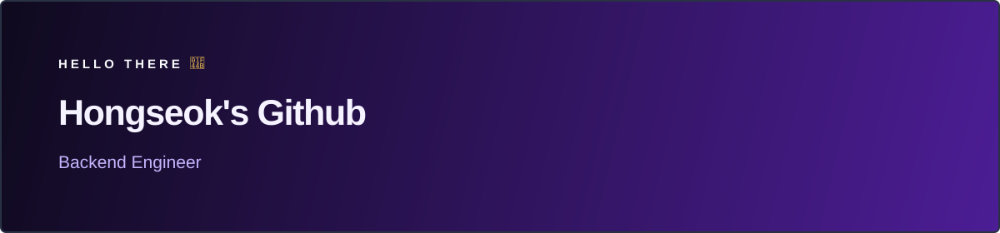

  

    

      👋 안녕하세요! <b>안정적으로 성장하는 개발자 현홍석</b>입니다. 
      <b>신뢰할 수 있는 시스템 개발</b>을 최우선으로, 
      항상 <b>구조와 흐름</b>을 의식하며 문제를 해결하려 노력합니다. 
      꾸준한 성장을 통해 웹 개발, AI를 넘어 다양한 IT 영역을 실제 문제에 연결하는 엔지니어입니다.
    

  

 

## 🧑‍💻 About Me
-  Graduated from Ajou University
- 💻 Digital Media major · Software double major

 

## 📂 Github

    

 

## ✨ Activities
- LG U+ Ureca 교육과정 3기 (2025.08 ~ 2026.03)
- LG U+ Ureca 3기 SW 최종융합프로젝트 최우수상 (2026.03.24)
  
 

## 🛠 Tech Stack

  
  &nbsp;
  &nbsp;
  &nbsp;
  &nbsp;
  &nbsp;
   
  &nbsp;
  &nbsp;
  &nbsp;
  &nbsp;
  &nbsp;
  

 

## 📚 Studying

  &nbsp
  &nbsp;
  &nbsp;

 

## 🔧 Tools

  &nbsp
  &nbsp
  &nbsp;
  &nbsp;

 

## 📫Contact

  &nbsp;
  

